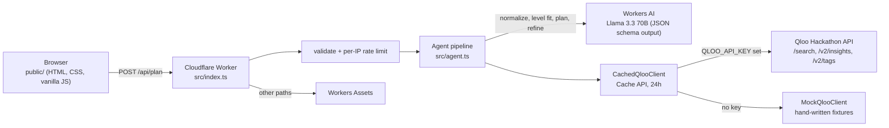

# Taste-to-English

**Turn the Japanese anime, games and novels you love into an English reading, listening and watching plan at your level, built on Qloo's cross-domain taste graph.**

Live demo: `https://taste-to-english.<subdomain>.workers.dev` <!-- TODO DEMO_URL: replace with the deployed URL -->

Built for the Qloo Agentic Hackathon.

---

## The problem

Japanese learners of English are told to do *extensive reading and listening* (多読・多聴): lots of easy, enjoyable input. In practice, graded readers and textbook podcasts rarely match what learners actually enjoy, so they lose motivation and quit.

Learners already know what they love, in Japanese: anime, light novels, games, films. What's hard is the next step. How do you get from "I love *Spirited Away*, *Persona 5* and Haruki Murakami" to "these three English books, two podcasts and one TV series, at my level, in this order, this week"?

## What it does

1. **Enter 1–5 favourite works** in any language and any domain (book, movie, TV, anime, game, podcast, artist). A type hint is optional.
2. **Pick your level** (CEFR A2 / B1 / B2 / C1), minutes per day (10 / 20 / 30 / 45) and formats (read / listen / watch).
3. **Build my plan.** The agent runs and shows a live **agent trace**, so you can see each step and why it chose what it did.
4. **Get your result:**
   - **Taste profile**: the top taste tags Qloo associates with your favourites.
   - **Picks**: 6–9 English books, podcasts, TV shows and films. Each one shows its Qloo affinity, an estimated CEFR difficulty with a one-line reason, a *because you like X* line, and a badge saying whether it is easier than your level, a match, or a stretch.
   - **7-day plan**: one activity per day sized to your minutes, alternating formats, easiest first.
   - **Starter vocabulary**: 12 words or phrases for day 1, with a Japanese gloss and an example sentence. These are marked as AI-generated.
5. **Refine** with free text such as "less fantasy, more mystery" or "only things after 2010". The agent maps this to Qloo tag signals and year filters, then re-runs.

## Why Qloo is essential

On its own, an LLM guesses popular English titles and drifts toward generic bestsellers. The link the learner needs is **cross-domain**: from a Japanese *game* to an English *podcast*, or from a Ghibli *film* to an English *novel*. That link is exactly what Qloo's taste graph models.

In this app:

- **Qloo picks every candidate.** The LLM never proposes titles. It only translates input titles, estimates difficulty and writes the schedule.
- **Every "because you like X" line comes from Qloo data** (explainability, then shared tags, then affinity), never from the LLM.
- **Without Qloo there is nothing to rank.** The picks would turn back into the generic "read Harry Potter" advice the learner already ignored.

## How Qloo is used

All calls are `GET` requests to `https://hackathon.api.qloo.com` with the `X-Api-Key` header. The key is sent from the Worker only, never from the browser.

| Step | Endpoint | Purpose | Key params |
|---|---|---|---|
| Resolve favourites | `GET /search` | Turn each normalised title into a Qloo entity. It tries with the type filter first, then without. | `query`, `types=urn:entity:<type>`, `take=5` |
| Taste profile | `GET /v2/insights` with `filter.type=urn:tag` | Tags Qloo associates with the resolved favourites. The top 8 by affinity become the profile. | `filter.type=urn:tag`, `signal.interests.entities=<ids>`, `take=20` |
| Recommend | `GET /v2/insights`, once per media type (`urn:entity:book`, `urn:entity:podcast`, `urn:entity:tv_show`, `urn:entity:movie`) | Cross-domain recommendations from the favourites, with the reasons attached | `filter.type`, `signal.interests.entities=<ids>`, `filter.exclude.entities=<ids>`, `feature.explainability=true`, `take=15`; on refine also `signal.interests.tags=<tag ids>` and year filters (`filter.publication_year.min/max` for books, `filter.release_year.min/max` for movies and TV) |
| Refine | `GET /v2/tags` | Map free-text wishes ("more mystery") to real Qloo tag IDs | `filter.query`, `feature.semantic_search=true`, `take=3` |

Array params are sent as one comma-joined value. For games, if the API rejects `urn:entity:videogame`, the client retries once with `urn:entity:video_game`. Each Qloo client call's parsed, non-empty result is cached server-side for 24 hours (see Architecture). More detail: [`docs/qloo-api-notes.md`](docs/qloo-api-notes.md).

## Example: request → result

The request below is the body of `POST /api/plan`:

```json
{
  "favorites": [
    { "title": "千と千尋の神隠し" },
    { "title": "Persona 5", "type": "videogame" }
  ],
  "level": "B1",
  "minutesPerDay": 20,
  "formats": ["read", "listen"]
}
```

What the agent does, step by step. Responses are shown in **mock mode**. The mock fixtures are hand-written by us and are not Qloo data. Live mode returns the same shape.

1. **Normalize (LLM).** `千と千尋の神隠し` becomes `"Spirited Away"` (movie). `Persona 5` keeps its user-given type.
2. **Resolve (Qloo `/search`).**
   ```http
   GET /search?query=Spirited+Away&types=urn:entity:movie&take=5
   X-Api-Key: ***
   ```
   The agent prefers an exact name match, otherwise it takes the top hit. Result: `Spirited Away` (movie) and `Persona 5` (videogame).
3. **Taste profile (Qloo `/v2/insights`, tags).**
   ```http
   GET /v2/insights?filter.type=urn:tag&signal.interests.entities=<spirited-away-id>,<persona-5-id>&take=20
   X-Api-Key: ***
   ```
   The tags are sorted by affinity and the top 8 are kept: *Coming Of Age, Fantasy, Japan, Adventure, Animation, Friendship, Mystery*.
4. **Recommend (Qloo `/v2/insights`, one call per type).**
   ```http
   GET /v2/insights?filter.type=urn:entity:book&signal.interests.entities=<ids>&filter.exclude.entities=<ids>&feature.explainability=true&take=15
   X-Api-Key: ***
   ```
   The top book candidates are *Harry Potter and the Philosopher's Stone* (affinity 1.0) and *Kafka on the Shore* (0.86). The top podcast candidates are *ANNCast* and *Myths and Legends*. Each candidate carries its tags and an explainability block that names which favourite drove it.
5. **Level fit (LLM).** One call estimates the CEFR level of every candidate. The agent keeps candidates within one level of B1, takes 6–9 of them with at least 2 per format, and orders them easiest first.
6. **Explain (deterministic, Qloo only).** A pick named in the explainability block gets `"Because you like Persona 5"`. Otherwise the agent counts shared tags, for example `"Shares Fantasy and Japan with Spirited Away"`, and falls back to the affinity score.
7. **Plan and vocabulary (LLM).** The LLM writes a 7-day schedule from the picks and 12 starter words for the day-1 item.

The response has this shape (trimmed):

```json
{
  "mode": "mock",
  "profile": [{ "id": "urn:tag:keyword:media:fantasy", "name": "Fantasy", "affinity": 1 }],
  "picks": [{
    "id": "mock-book-harry-potter-1",
    "name": "Harry Potter and the Philosopher's Stone",
    "type": "book", "year": 1997, "affinity": 1,
    "cefr": "B1", "levelReason": "Plain narrative English, some invented words",
    "fit": "match", "format": "read",
    "because": "Because you like Persona 5"
  }],
  "plan": [{ "day": 1, "pickId": "mock-book-harry-potter-1", "activity": "Read chapter 1 (about 12 pages)", "minutes": 20 }],
  "vocab": [{ "term": "cupboard", "ja": "戸棚", "example": "He slept in a cupboard under the stairs." }],
  "trace": [{ "id": "normalize", "label": "Understanding your favourites", "detail": "\"千と千尋の神隠し\" → \"Spirited Away\" (movie); …", "ms": 812 }],
  "warnings": []
}
```

The CEFR level, reason, plan and vocabulary values above are illustrative LLM output.

`warnings` lists problems that did not stop the plan:

- `Couldn't find "<title>"`: a favourite didn't resolve in Qloo and was skipped.
- `Qloo couldn't search <type>s this time`: one media type's recommendation call failed. The other types still count. The step fails only if every type fails.
- `Only N works matched your level closely`: fewer than 6 picks were left after the level filter.
- `Only N starter words could be written this time`: the model returned fewer than 12 vocabulary items.

Error responses (all `/api/*` responses send `cache-control: no-store`):

| Status | Meaning | Body |
|---|---|---|
| `400` | Body is not valid JSON, or fails validation | `{ error }` |
| `404` | Unknown `/api/*` path | `{ error: "Not found" }` |
| `405` | `/api/plan` with a method other than `POST` | `{ error }` |
| `429` | More than 20 plans this hour from your IP | `{ error: "Too many plans this hour, try again later." }` |
| `500` | Unexpected server error (details go to the Worker log only) | `{ error: "Something went wrong" }` |
| `502` | A pipeline step failed | `{ error, step, trace }`. `step` is one of `normalize`, `resolve`, `profile`, `refine`, `recommend`, `level`, `explain`, `plan`. `error` is a fixed, user-facing message; raw upstream errors are never returned. |

`GET /api/health` returns `{ "ok": true, "mode": "live" | "mock" }`.

## Architecture



- One Cloudflare Worker written in TypeScript. Static assets in `public/` are served by Workers Assets, and `/api/*` runs in the Worker first.
- **Workers AI** (`@cf/meta/llama-3.3-70b-instruct-fp8-fast`) returns structured JSON through `response_format: json_schema`. It sits behind a small interface, so the tests use a fake.
- **Qloo client** (`src/qloo.ts`) has an HTTP implementation and a mock implementation. The app is in live mode exactly when the `QLOO_API_KEY` secret is set, and the UI labels mock mode clearly.
- The **Cache API** (`caches.default`) stores the parsed result of each Qloo client call (`search`, `insights`, `entityTags`, `searchTags`) for 24 hours. The key is a synthetic URL, `https://qloo-cache.local/v1-<live|mock>/<method>?<sorted args>`, so live and mock results never mix. The API key is never part of the key or the stored body. Empty results are not cached, and cache failures fall back to a direct call. Qloo requests time out after 10 seconds.
- **Agent details**: the recommend step drops works whose `language` is set and isn't English. The level step sends at most 40 candidates to the model, taken round-robin across media types, and asks once more for any the model skipped. Refine's "less of" phrases remove candidates with a tag matching that phrase as a whole word; this costs no Qloo call.
- **Abuse guard**: 20 plans per IP per hour (best effort), plus input caps of ≤ 5 favourites, titles ≤ 80 characters and refine text ≤ 200 characters.

Design notes: [`docs/design.md`](docs/design.md).

## Responsible data handling

- **Only public titles go to Qloo.** That means names of published works, entity and tag IDs, and year filters. No personal data is sent.
- **No accounts and no storage.** There is no database and no login, and plans are not saved. The only server-side state is the Qloo response cache and a short-lived per-IP request counter.
- **The key stays on the server.** `QLOO_API_KEY` is a Wrangler secret. It never reaches the browser and is never in the repo.
- **Qloo results are aggregate taste patterns.** They reflect what people with similar tastes enjoy, not a profile of you.
- **CEFR levels are estimates.** The LLM produces them from the title, type and description. Vocabulary is marked AI-generated, so check it in a dictionary.
- **There is no Qloo data in this repo.** The mock fixtures in `src/mock-data.ts` are hand-written approximations of well-known public works, and the file header says so.

## Run it yourself

Requirements: Node.js 22+ and a free Cloudflare account. Workers AI runs on Cloudflare even during local development, so `npx wrangler dev` asks you to log in once.

```bash
npm install
npx wrangler dev          # http://localhost:8787, mock mode, no Qloo key needed
npm test                  # vitest: validation, Qloo client, agent pipeline, routes
npx tsc --noEmit          # type-check
```

**Live mode** with a Qloo hackathon key:

```bash
# local: copy the example file and put your key in .dev.vars (gitignored)
cp .dev.vars.example .dev.vars

# deployed: store the key as a Worker secret, then deploy
npx wrangler secret put QLOO_API_KEY
npx wrangler deploy
```

`GET /api/health` shows which mode is active.

Configuration (`wrangler.jsonc` plus secrets):

| Name | Kind | Purpose |
|---|---|---|
| `QLOO_API_KEY` | secret, optional | Its presence switches the app to live mode |
| `QLOO_BASE_URL` | var | Qloo API origin, default `https://hackathon.api.qloo.com` |
| `AI` | Workers AI binding | The LLM |
| `ASSETS` | Workers Assets binding | Serves `public/`; `/api/*` runs in the Worker first |

`npm run dev`, `npm run deploy` and `npm run type-check` wrap the matching `wrangler` / `tsc` commands.

## Limits

- **The mock dataset is small.** It has a few dozen hand-written titles, so mock-mode picks repeat across inputs. Live mode needs a Qloo hackathon key.
- **Difficulty is an LLM estimate,** not a measured readability score. When few candidates land near your level, you get fewer than 6 picks and a warning.
- **Qloo coverage varies by title.** Niche Japanese works may not resolve. The trace says which favourites were skipped.
- **The rate limit and cache are per Cloudflare data centre and best effort.** They are not globally exact, and parallel requests can slip past the counter. Both use the Cache API, which may not persist anything on a `*.workers.dev` hostname. Check after deploying, for example by confirming that the 21st plan in an hour gets a `429`. A custom domain makes both effective.
- **The UI is in English** with Japanese glosses. There is no progress tracking, no saved plans and no audio playback.

## License

MIT. See [LICENSE](LICENSE).
