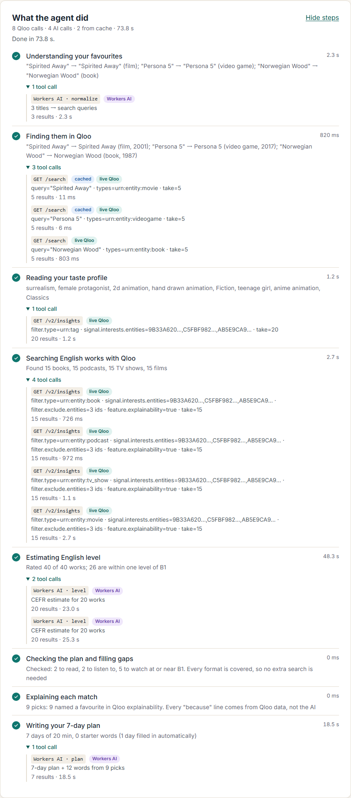
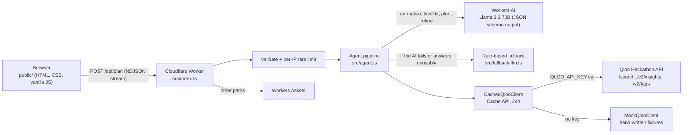

# Taste-to-English

**Turn the Japanese anime, games and novels you love into an English reading, listening and watching plan at your level, built on Qloo's cross-domain taste graph.**

Live demo: https://taste-to-english.shotaro-takakura.workers.dev (live Qloo data; add `?demo=1` to force the hand-written sample mode)

Built for the Qloo Agentic Hackathon. No key handy? Open the demo with `?demo=1` to run it on a small hand-written sample set (clearly labelled).



---

## The problem

Japanese learners of English are told to do *extensive reading and listening* (多読・多聴): lots of easy, enjoyable input. In practice, graded readers and textbook podcasts rarely match what learners actually enjoy, so they lose motivation and quit.

Learners already know what they love, in Japanese: anime, light novels, games, films. What's hard is the next step. How do you get from "I love *Spirited Away*, *Persona 5* and Haruki Murakami" to "these three English books, two podcasts and one TV series, at my level, in this order, this week"?

## What it does

1. **Enter 1–5 favourite works** in any language and any domain (book, movie, TV, anime, game, podcast, artist). A type hint is optional.
2. **Pick your level** (CEFR A2 / B1 / B2 / C1), minutes per day (10 / 20 / 30 / 45) and formats (read / listen / watch).
3. **Build my plan.** The agent runs and streams a live **agent trace**: every step, and inside it every tool call (Qloo endpoint and parameters, result count, time, cache hit, live/sample, Workers AI or rule-based). Before it writes the plan, the agent **checks its own picks** against your request; if a format came up short at your level, it decides to query Qloo again with your taste-profile tags as an extra signal, and the trace says why.
4. **Get your result:**
   - **What Qloo matched**: what each favourite resolved to in Qloo (e.g. 千と千尋の神隠し → *Spirited Away*, 2001) and the cross-domain jump ("From 1 film and 1 game → 3 books, 2 podcasts and 3 shows").
   - **Taste profile**: the top taste tags Qloo associates with your favourites, with affinity.
   - **Picks**: 6–9 English books, podcasts, TV shows and films. Each one shows its Qloo affinity, an estimated CEFR difficulty with a one-line reason, a *because you like X* line, and a badge saying whether it is easier than your level, a match, or a stretch. **Why this pick** opens Qloo's evidence: which favourites drove it (explainability scores), the taste tags it shares, and its popularity percentile.
   - **7-day plan**: one activity per day sized to your minutes, alternating formats, easiest first.
   - **Starter vocabulary**: 12 words or phrases for day 1, with a Japanese gloss and an example sentence. These are marked as AI-generated.
5. **Refine** with free text such as "less fantasy, more mystery" or "only things after 2010". The agent maps this to Qloo tag signals and year filters, then re-runs.
6. **When things go wrong it says so and keeps going**: if Workers AI fails, a deterministic rule-based fallback answers that step (marked in the trace, with a warning); if live Qloo fails, the error offers **Try with sample data**; a long run shows which step it is on, and can be cancelled.

## Why Qloo is essential

On its own, an LLM guesses popular English titles and drifts toward generic bestsellers. The link the learner needs is **cross-domain**: from a Japanese *game* to an English *podcast*, or from a Ghibli *film* to an English *novel*. That link is exactly what Qloo's taste graph models.

In this app:

- **Qloo picks every candidate.** The LLM never proposes titles. It only translates input titles, estimates difficulty and writes the schedule.
- **Every "because you like X" line and every "Why this pick" panel comes from Qloo data** (explainability, then shared tags, then affinity), never from the LLM.
- **The agent's second look also goes through Qloo.** When coverage is short it asks Qloo again with a different signal (the learner's taste-profile tags), instead of asking the LLM for more titles.
- **Without Qloo there is nothing to rank.** The picks would turn back into the generic "read Harry Potter" advice the learner already ignored.

## How Qloo is used

All calls are `GET` requests to `https://hackathon.api.qloo.com` with the `X-Api-Key` header. The key is sent from the Worker only, never from the browser.

| Step | Endpoint | Purpose | Key params |
|---|---|---|---|
| Resolve favourites | `GET /search` | Turn each normalised title into a Qloo entity. It tries with the type filter first, then without. | `query`, `types=urn:entity:<type>`, `take=5` |
| Taste profile | `GET /v2/insights` with `filter.type=urn:tag` | Tags Qloo associates with the resolved favourites. The top 8 by affinity become the profile. | `filter.type=urn:tag`, `signal.interests.entities=<ids>`, `take=20` |
| Recommend | `GET /v2/insights`, once per media type (`urn:entity:book`, `urn:entity:podcast`, `urn:entity:tv_show`, `urn:entity:movie`) | Cross-domain recommendations from the favourites, with the reasons attached | `filter.type`, `signal.interests.entities=<ids>`, `filter.exclude.entities=<ids>`, `feature.explainability=true`, `take=15`; on refine also `signal.interests.tags=<tag ids>` and year filters (`filter.publication_year.min/max` for books, `filter.release_year.min/max` for movies and TV) |
| Self-check (only when a format is short) | `GET /v2/insights` for the short types | Widen the search with a different signal | `signal.interests.entities=<ids>`, `signal.interests.tags=<top 3 profile tag ids>`, `filter.exclude.entities=<everything already seen>`, `feature.explainability=true`, `take=15` |
| Refine | `GET /v2/tags` | Map free-text wishes ("more mystery") to real Qloo tag IDs | `filter.query`, `feature.semantic_search=true`, `take=3` |

Array params are sent as one comma-joined value. For games, if the API rejects `urn:entity:videogame`, the client retries once with `urn:entity:video_game`. Each Qloo client call's parsed, non-empty result is cached server-side for 24 hours (see Architecture). More detail: [`docs/qloo-api-notes.md`](docs/qloo-api-notes.md).

## Example: request → result

The request below is the body of `POST /api/plan`:

```json
{
  "favorites": [
    { "title": "千と千尋の神隠し" },
    { "title": "Persona 5", "type": "videogame" }
  ],
  "level": "B1",
  "minutesPerDay": 20,
  "formats": ["read", "listen"]
}
```

What the agent does, step by step. Responses are shown in **mock mode**. The mock fixtures are hand-written by us and are not Qloo data. Live mode returns the same shape.

1. **Normalize (LLM).** `千と千尋の神隠し` becomes `"Spirited Away"` (movie). `Persona 5` keeps its user-given type.
2. **Resolve (Qloo `/search`).**
   ```http
   GET /search?query=Spirited+Away&types=urn:entity:movie&take=5
   X-Api-Key: ***
   ```
   The agent prefers an exact name match, otherwise it takes the top hit. Result: `Spirited Away` (movie) and `Persona 5` (videogame).
3. **Taste profile (Qloo `/v2/insights`, tags).**
   ```http
   GET /v2/insights?filter.type=urn:tag&signal.interests.entities=<spirited-away-id>,<persona-5-id>&take=20
   X-Api-Key: ***
   ```
   The tags are sorted by affinity and the top 8 are kept: *Coming Of Age, Fantasy, Japan, Adventure, Animation, Friendship, Mystery*.
4. **Recommend (Qloo `/v2/insights`, one call per type).**
   ```http
   GET /v2/insights?filter.type=urn:entity:book&signal.interests.entities=<ids>&filter.exclude.entities=<ids>&feature.explainability=true&take=15
   X-Api-Key: ***
   ```
   The top book candidates are *Harry Potter and the Philosopher's Stone* (affinity 1.0) and *Kafka on the Shore* (0.86). The top podcast candidates are *ANNCast* and *Myths and Legends*. Each candidate carries its tags and an explainability block that names which favourite drove it.
5. **Level fit (LLM).** The model estimates the CEFR level of every candidate. The agent keeps candidates within one level of B1, takes 6–9 of them with at least 2 per format, and orders them easiest first.
6. **Explain (deterministic, Qloo only; runs after the self-check).** A pick named in the explainability block gets `"Because you like Persona 5"`. Otherwise the agent counts shared tags, for example `"Shares Fantasy and Japan with Spirited Away"`, and falls back to the affinity score.
7. **Self-check (agent).** Before explaining, the agent counts picks per format. If one is short (e.g. only one podcast fits A2), it calls `/v2/insights` again for that type with the top taste-profile tags added as `signal.interests.tags` and every work already seen excluded, rates just the new works and re-selects. Otherwise the trace records "no extra search is needed".
8. **Plan and vocabulary (LLM).** The LLM writes a 7-day schedule from the picks and 12 starter words for the day-1 item.

The response has this shape (trimmed):

```json
{
  "mode": "mock",
  "seeds": [{ "id": "mock-movie-spirited-away", "name": "Spirited Away", "type": "movie", "year": 2001, "input": "千と千尋の神隠し" }],
  "profile": [{ "id": "urn:tag:keyword:media:fantasy", "name": "Fantasy", "affinity": 1 }],
  "picks": [{
    "id": "mock-book-harry-potter-1",
    "name": "Harry Potter and the Philosopher's Stone",
    "type": "book", "year": 1997, "affinity": 1,
    "cefr": "B1", "levelReason": "Plain narrative English, some invented words",
    "fit": "match", "format": "read",
    "because": "Because you like Persona 5",
    "evidence": { "contributions": [{ "seedId": "mock-game-persona-5", "name": "Persona 5", "score": 0.5 }], "sharedTags": ["Fantasy", "Friendship"] }
  }],
  "plan": [{ "day": 1, "pickId": "mock-book-harry-potter-1", "activity": "Read chapter 1 (about 12 pages)", "minutes": 20 }],
  "vocab": [{ "term": "cupboard", "ja": "戸棚", "example": "He slept in a cupboard under the stairs." }],
  "trace": [{
    "id": "resolve", "label": "Finding them in Qloo", "status": "ok", "ms": 412,
    "detail": "\"千と千尋の神隠し\" → Spirited Away (film, 2001); …",
    "calls": [{ "tool": "qloo.search", "endpoint": "GET /search", "summary": "query=\"Spirited Away\" · types=urn:entity:movie · take=5",
                "results": 1, "ms": 180, "cached": false, "ok": true, "source": "sample" }]
  }],
  "warnings": []
}
```

The CEFR level, reason, plan and vocabulary values above are illustrative LLM output.

A step's `status` is `ok`, `fallback` (the rule-based fallback answered an AI call) or `failed`. A call's `source` is `qloo` (live), `sample` (hand-written demo data), `workers-ai` or `rule-based`. Calls never contain the key or a URL.

**Streaming.** Send `Accept: application/x-ndjson` and the same endpoint streams one JSON event per line as the agent works: `start` (mode and planned steps), `step-start`, `call`, `step` (finished, with its calls), then exactly one `result` (the body above) or `error` (`{ error, step, trace }`). The page uses this; validation, rate-limit and method errors are still plain JSON responses.

**Demo runs.** Add `"demo": true` to the body to use the hand-written sample set even when a key is configured (the page's **Try with sample data** button and `?demo=1`). Demo runs have their own rate-limit allowance.

`warnings` lists problems that did not stop the plan:

- `Couldn't find "<title>"`: a favourite didn't resolve in Qloo and was skipped.
- `Qloo couldn't search <type>s this time`: one media type's recommendation call failed. The other types still count. The step fails only if every type fails.
- `Only N works matched your level closely`: fewer than 6 picks were left after the level filter.
- `Only N starter words could be written this time`: the model returned fewer than 12 vocabulary items.
- `The AI model was unavailable for part of this run, …`: at least one step used the rule-based fallback.
- `Nothing to listen to matched your level this time` (or read / watch): a chosen format has no pick even after the self-check.

Error responses (all `/api/*` responses send `cache-control: no-store`):

| Status | Meaning | Body |
|---|---|---|
| `400` | Body is not valid JSON, or fails validation | `{ error }` |
| `404` | Unknown `/api/*` path | `{ error: "Not found" }` |
| `405` | `/api/plan` with a method other than `POST` | `{ error }` |
| `413` | Body larger than 8 KB | `{ error }` |
| `429` | More than 30 plans this hour from your IP (IPv6: your /64) | `{ error: "Too many plans this hour, try again later." }` |
| `500` | Unexpected server error (details go to the Worker log only) | `{ error: "Something went wrong" }` |
| `502` | A pipeline step failed | `{ error, step, trace }`. `step` is one of `normalize`, `resolve`, `profile`, `refine`, `recommend`, `level`, `review`, `explain`, `plan`. `error` is a fixed, user-facing message; raw upstream errors are never returned. |

`GET /api/health` returns `{ "ok": true, "mode": "live" | "mock" }`.

## Architecture



- One Cloudflare Worker written in TypeScript. Static assets in `public/` are served by Workers Assets, and `/api/*` runs in the Worker first.
- **Workers AI** (`@cf/meta/llama-3.3-70b-instruct-fp8-fast`) returns structured JSON through `response_format: json_schema`. It sits behind a small interface, so the tests use a fake.
- **Qloo client** (`src/qloo.ts`) has an HTTP implementation and a mock implementation. The app is in live mode exactly when the `QLOO_API_KEY` secret is set, and the UI labels mock mode clearly.
- The **Cache API** (`caches.default`) stores the parsed result of each Qloo client call (`search`, `insights`, `entityTags`, `searchTags`) for 24 hours. The key is a synthetic URL, `https://qloo-cache.local/v2-<live|mock>/<method>?<sorted args>`, so live and mock results never mix. The API key is never part of the key or the stored body. Empty results are not cached, and cache failures fall back to a direct call. Qloo requests time out after 10 seconds.
- **Agent details**: the recommend step drops works whose `language` is set and isn't English. The level step sends at most 40 candidates to the model, taken round-robin across media types, and asks once more for any the model skipped. Refine's "less of" phrases remove candidates with a tag matching that phrase as a whole word; this costs no Qloo call.
- **Agent trace**: `runPlan` wraps the Qloo client and the LLM with recorders, so each call is attached to the step that made it and streamed to the page. Cache hits are detected without widening the client interface.
- **Model output is untrusted**: every prompt tells the model the input block is data, not instructions; candidate ids are enum-constrained and re-checked; links are stripped from model-written text; answers that rate nothing fall back to rules.
- **Abuse guard**: 30 plans per IP (IPv6: per /64) per hour, best effort; demo runs counted separately. Input caps: ≤ 5 favourites, titles ≤ 80 characters, refine text ≤ 200 characters, body ≤ 8 KB. A streamed run stops when the browser goes away. The Qloo client never follows redirects, so the key header can't be forwarded elsewhere.

Design notes: [`docs/design.md`](docs/design.md).

## Responsible data handling

- **Only what you type as titles goes to Qloo** (plus entity and tag IDs and year filters). The page asks you not to enter personal details. Nothing else about you is sent.
- **No accounts and no storage.** There is no database and no login, and plans are not saved. The only server-side state is the Qloo response cache and a short-lived per-IP request counter.
- **The key stays on the server.** `QLOO_API_KEY` is a Wrangler secret. It never reaches the browser and is never in the repo.
- **Qloo results are aggregate taste patterns.** They reflect what people with similar tastes enjoy, not a profile of you.
- **CEFR levels are estimates.** The LLM produces them from the title, type and description (or simple rules when the AI is unavailable, marked as such). Vocabulary is marked AI-generated, so check it in a dictionary.
- **Every source is labelled.** Live Qloo data, hand-written sample data, Workers AI answers and rule-based answers are badged separately in the trace and the results.
- **There is no Qloo data in this repo.** The mock fixtures in `src/mock-data.ts` are hand-written approximations of well-known public works, and the file header says so.

## Run it yourself

Requirements: Node.js 22+. Nothing else for the offline demo; a free Cloudflare account for Workers AI.

```bash
npm install
npm run dev:offline       # http://localhost:8799, no account, no key: sample data + rule-based AI fallback
npx wrangler dev          # http://localhost:8787, sample data + Workers AI (asks you to log in to Cloudflare once)
npm test                  # vitest: validation, Qloo client, agent pipeline, routes
npx tsc --noEmit          # type-check
```

**Live mode** with a Qloo hackathon key:

```bash
# local: copy the example file and put your key in .dev.vars (gitignored)
cp .dev.vars.example .dev.vars

# deployed: store the key as a Worker secret, then deploy
npx wrangler secret put QLOO_API_KEY
npx wrangler deploy
```

`GET /api/health` shows which mode is active. After the key arrives, `node scripts/qloo-smoke.mjs` checks the live API (it prints only status codes, counts and field names). Deployment and the post-key checklist: [`docs/next-steps.md`](docs/next-steps.md).

Configuration (`wrangler.jsonc` plus secrets):

| Name | Kind | Purpose |
|---|---|---|
| `QLOO_API_KEY` | secret, optional | Its presence switches the app to live mode |
| `QLOO_BASE_URL` | var | Qloo API origin, default `https://hackathon.api.qloo.com` |
| `AI` | Workers AI binding | The LLM. `wrangler.offline.jsonc` omits it for the offline demo |
| `ASSETS` | Workers Assets binding | Serves `public/`; `/api/*` runs in the Worker first |

`npm run dev`, `npm run deploy` and `npm run type-check` wrap the matching `wrangler` / `tsc` commands.

## Limits

- **Offline, the AI steps are rough rules.** Without Workers AI every level estimate comes from type, length and audience words, so picks cluster around one level; the deployed app uses the model.
- **The mock dataset is small.** It has a few dozen hand-written titles, so mock-mode picks repeat across inputs. Live mode needs a Qloo hackathon key.
- **Difficulty is an LLM estimate,** not a measured readability score. When few candidates land near your level, you get fewer than 6 picks and a warning.
- **Qloo coverage varies by title.** Niche Japanese works may not resolve. The trace says which favourites were skipped.
- **The rate limit and cache are per Cloudflare data centre and best effort.** They are not globally exact, and parallel requests can slip past the counter. Both use the Cache API, which may not persist anything on a `*.workers.dev` hostname. Check after deploying, for example by confirming that the 31st plan in an hour gets a `429`. A custom domain makes both effective.
- **The UI is in English** with Japanese glosses. There is no progress tracking, no saved plans and no audio playback.

## More docs

- [`docs/qloo-integration-decision.md`](docs/qloo-integration-decision.md): why the Worker calls the Qloo API directly and how to switch to a gateway or the harness
- [`docs/next-steps.md`](docs/next-steps.md): deploy, add the key, verify
- [`docs/license-check.md`](docs/license-check.md): licenses of everything we ship or call
- [`docs/screenshots/`](docs/screenshots/): screenshots (01–06 live Qloo data and Workers AI; 07–11 sample data)

## License

MIT. See [LICENSE](LICENSE). Built with Llama: the AI steps run Meta Llama 3.3 on Workers AI under the [Llama 3.3 Community License](https://www.llama.com/llama3_3/license/).
